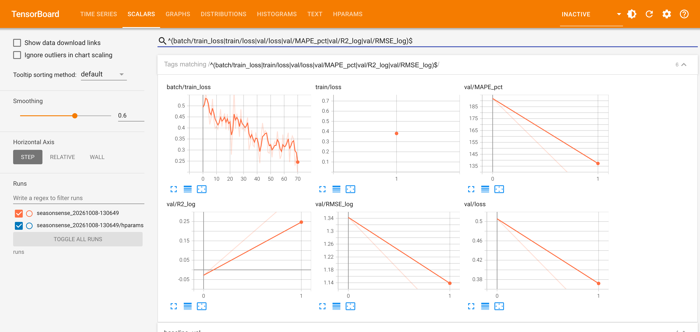

# SeasonSense: District Crop-Yield Forecasting for Rwanda

**NISR 2026 Big Data Hackathon · Track 1: Agricultural Productivity · Team Great Minds**

SeasonSense forecasts season-level crop yields (kg/ha) for all 30 districts of Rwanda and 17 crops. It
combines the NISR Seasonal Agricultural Survey (SAS) district tables with in-season ERA5 weather. The aim
is an early-warning and targeting tool for MINAGRI/RAB planners, district agronomists and food-security
analysts: it shows which district-crop combinations are heading for a shortfall and how much of that gap
comes from weather versus farm practices (fertiliser, improved seed, pesticides, erosion control).

## Data

| Source | What | Access |
|---|---|---|
| NISR Seasonal Agricultural Survey 2023, 2024, 2025 (annual tables) and 2026 Season A | District × crop average yield; % of farmers using inorganic/organic fertiliser, improved seed, pesticides, erosion control | Public Excel annexes on [statistics.gov.rw](https://statistics.gov.rw) |
| Open-Meteo ERA5 archive API | Daily rainfall, Tmax, Tmin, FAO ET0 and elevation at each district centroid (Sep 2022 to Feb 2026) | Free, no key |
| geoBoundaries gbOpen RWA ADM2 | District polygons, used to compute centroids | Open (CC BY 4.0) |

The panel covers 7 seasons (2023A to 2026A), 30 districts, 17 crops and 3,178 district-crop-season rows.

## Model

`SeasonSenseNet` (PyTorch, about 8.3k parameters) has three branches:

* a **GRU** that encodes the 22-week in-season weather sequence (rain, Tmax, Tmin, ET0, water balance, dry days)
* **entity embeddings** for district, crop and season type (A/B)
* a dense branch for the farm-practice adoption rates and elevation

The branches are concatenated and fed to an MLP head that predicts standardised log-yield, trained with Huber loss.
The split is temporal: train on 2023A to 2025A, validate on 2025B, test on 2026A.

## Run it

```bash
python -m venv .venv && source .venv/bin/activate
pip install -r requirements.txt
jupyter nbconvert --to notebook --execute --inplace nisr_yield_pipeline.ipynb   # or open it in Jupyter / Colab
tensorboard --logdir runs
```

The notebook downloads any missing data automatically (the cached copies are in `data/raw/`).

> **Status:** this is a proposal-stage **placeholder run of 1 epoch**. It proves that the pipeline works end to end
> (raw NISR Excel → features → model → TensorBoard → 2026A forecast CSV). The metrics are **not** final results.

## TensorBoard logging

* Scalars: per-batch loss and gradient norm; epoch train and validation loss; validation MAPE, median APE, RMSE(log) and R²(log); naive-baseline metrics; per-crop validation MAPE; test metrics
* Model graph, weight histograms, config text and HParams


